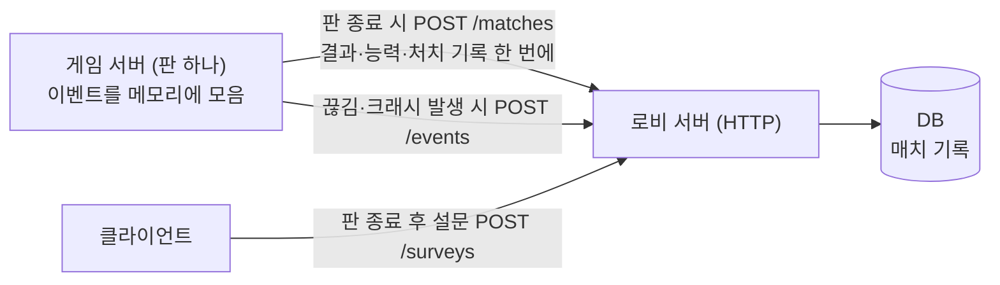
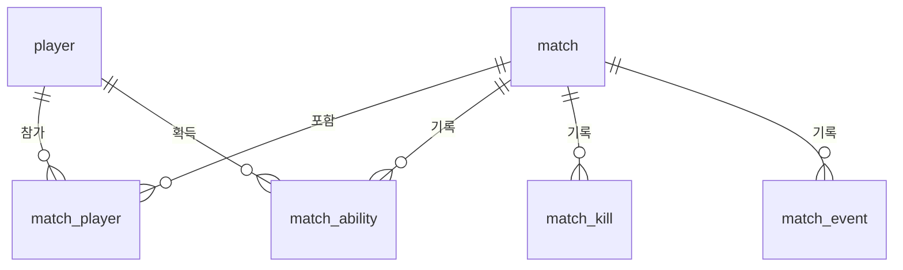

# DB 설계 — DB 연동이 필요한 기능 목록

- 작성일: 2026-10-20
- 상위 문서: [PRD.md](PRD.md) · 관련 문서: [ABILITY.md](ABILITY.md), [WEAPON.md](WEAPON.md)

---

## 1. 결론

**한 판을 진행하는 데는 DB가 필요 없고, 판이 끝난 뒤에도 남아야 하는 데이터(매치 기록과 밸런스 지표)에만 DB가 필요합니다.**

- 한 판 동안의 상태(위치·체력·자기장·능력 쿨타임)는 게임 서버 메모리에서 30Hz로 돌고, 판이 끝나면 버려도 됩니다.
- 공개 방 목록은 수명이 몇 분짜리라 로비 서버 메모리로 충분합니다.
- 설정·키 배치는 PRD대로 클라이언트의 `user://settings.cfg`에 저장합니다.
- 반면 PRD 8장 성공 지표(평균 판 길이, 능력 사용 횟수, 전설 능력 승률 등)와 ABILITY 6장 밸런스 목표는 **여러 판의 기록을 모아야** 계산할 수 있습니다. 이 부분 때문에 MVP에도 DB가 하나 필요합니다.

MVP 권장 구성은 **로비 서버 옆에 DB 하나(PostgreSQL, 초기엔 SQLite도 가능)를 두고 매치 기록만 저장**하는 것입니다. 계정·전적 페이지·랭크는 PRD 비목표이므로 넣지 않습니다.

---

## 2. 기능별 DB 필요 여부

### 2.1 DB가 필요한 기능

| 기능 | 저장하는 것 | 필요한 이유 | 우선순위 |
| --- | --- | --- | --- |
| 매치 결과 기록 | 판 시작·종료 시각, 판 길이, 인원, 승자, 매치 시드 | PRD 성공 지표 "평균 한 판 길이 8~12분" 계산 | P0 |
| 플레이어별 결과 | 순위, 처치, 가한/받은 데미지, 스폰 구역, 첫 교전 시각 | "스폰 후 첫 교전 2분 이내", 스폰 구역별 유불리 확인(PRD 8장 리스크) | P0 |
| 능력 획득·사용 기록 (`match_ability`) | 뽑은 능력, 등급, 획득 경로(시작·맵·처치), 사용 횟수, 교체로 버린 시점 | ABILITY 6장: 판당 능력 사용 15회 이상, 많이 버려지는 능력 상위 3개, 전설 보유자 승률 차 10%p 이하 | P0 |
| 처치 기록 (`match_kill`) | 처치자·피해자, 무기, 능력(터렛 등), 헤드샷 여부, 거리, 자기장 단계 | 능력 처치 비율 10% 이하 확인, 무기 밸런스(WEAPON 수치 조정) | P0 |
| 접속 끊김·크래시 기록 | 매치 ID, 플레이어, 시각, 사유 | 성공 지표 "끊김/크래시 20판당 1회 이하" | P0 |
| 사격 판정 체감 설문 | 판 종료 후 1~5점, 의견 | 성공 지표 "맞았는데 안 맞았다 4점 이상" (외부 설문 폼으로 대체 가능) | P1 |
| 플레이어 식별 | 기기 UUID ↔ 닉네임 | 위 기록을 "같은 사람의 여러 판"으로 묶기 위해. 계정 없이 클라이언트가 처음 실행할 때 만든 UUID 사용 | P0 |
| 영구 차단 | 차단된 기기 UUID, 사유, 기간 | 방장 강퇴만으로 부족해지면(공개 방 핵 사용자) | P2 |
| 채팅 신고 로그 | 신고된 메시지와 앞뒤 문맥 | 신고 처리용. 개인정보 보관 기간을 정해야 함 | P2 |

### 2.2 DB가 필요 없는 기능

| 기능 | 어디에 두나 | 이유 |
| --- | --- | --- |
| 공개 방 목록·인원·상태 | 로비 서버 메모리 | 방은 금방 사라지고, 서버가 재시작되면 다시 만들면 됨 |
| 한 판 진행 상태(위치·체력·탄약·자기장·능력 쿨타임) | 게임 서버 메모리 | 30Hz로 바뀌는 데이터, 판이 끝나면 필요 없음 |
| 60초 재접속 | 게임 서버 메모리 | 같은 판 안에서만 유효 |
| 시간 되감기용 3초 상태 기록 | 게임 서버 메모리 | 래그 보상 버퍼와 같은 링 버퍼 (ABILITY 7장) |
| 설정·키 배치 | 클라이언트 `user://settings.cfg` | PRD 4장에서 로컬 저장으로 정함 |
| 캐릭터 외형 | 클라이언트 로컬 + 입장 시 파츠 ID 전송 | PRD대로 파츠 ID만 동기화. 여러 PC에서 같은 외형을 쓰려면 그때 DB로 옮김 |
| 닉네임 | 클라이언트 로컬 | 계정이 없으므로. 기록용으로는 매치마다 그때의 닉네임을 같이 저장 |
| 개인 뮤트 | 클라이언트 로컬 | 나에게만 적용 |
| 방장 강퇴 | 로비·게임 서버 메모리 | 그 방에서만 유효 |
| 무기·능력 수치 | 정적 데이터 파일 (5장) | 빌드에 포함, 바꿀 때는 패치 |

### 2.3 범위 밖 (PRD 비목표)

계정·로그인, 전적 검색 페이지, 랭크·자동 매칭, 상점·과금, 친구 목록은 모두 DB가 필요하지만 이번 범위에서 하지 않습니다. 스팀 출시를 정하면(PRD 열린 질문) 플레이어 식별을 Steam ID로 바꿉니다.

---

## 3. 데이터 흐름

**게임 서버는 DB에 직접 붙지 않고, 판이 끝날 때 로비 서버 API로 결과를 한 번에 보냅니다.**



- 판 도중에는 DB에 쓰지 않습니다(30Hz 게임 루프에 영향 없음).
- 게임 서버가 비정상 종료되면 그 판 기록은 일부 잃어도 되는 것으로 봅니다. 대신 크래시 이벤트는 로비 서버가 프로세스 종료를 감지해 따로 남깁니다.
- 게임 서버 → 로비 서버 요청에는 서버끼리만 아는 키를 붙여, 클라이언트가 결과를 조작해 보내지 못하게 합니다.

---

## 4. 테이블 (MVP)



| 테이블 | 주요 컬럼 | 비고 |
| --- | --- | --- |
| `player` | `id`, `device_uuid`(유일), `last_nickname`, `created_at` | 계정 대신 기기 UUID |
| `match` | `id`, `room_name`, `seed`, `started_at`, `ended_at`, `duration_s`, `player_count`, `winner_player_id`, `build_version` | 시드가 있으면 스폰·아이템 배치를 재현 가능 |
| `match_player` | `match_id`, `player_id`, `nickname`, `spawn_zone`, `placement`, `kills`, `damage_dealt`, `damage_taken`, `ability_uses`, `first_engage_s`, `outfit`(JSON) | 판 하나에 최대 5행 |
| `match_ability` | `match_id`, `player_id`, `ability_id`, `grade`, `source`(start·map·kill), `acquired_s`, `slot`, `uses`, `discarded_s` | ABILITY 2.3: 뽑기 결과는 서버 난수로 정하고 여기에 남김 |
| `match_kill` | `match_id`, `t_s`, `killer_id`(자기장이면 NULL), `victim_id`, `weapon_id`, `ability_id`, `headshot`, `distance_m`, `zone_phase` | 터렛·충격파 처치는 `ability_id`에 기록 (ABILITY 5.4) |
| `match_event` | `match_id`, `player_id`, `t_s`, `type`(disconnect·reconnect·crash), `detail` | 끊김·크래시 지표 |
| `survey_response` | `match_id`, `player_id`, `hit_reg_score`(1~5), `comment` | P1, 외부 폼으로 대체 가능 |

예상 용량: 판 하나에 약 30~60행, 알파 테스트 수백 판 수준이라 SQLite 파일 하나로도 충분합니다.

### 지표 계산 예시

```sql
-- 평균 판 길이 (분)
SELECT AVG(duration_s) / 60.0 FROM match;

-- 능력으로 인한 처치 비율 (목표 10% 이하)
SELECT AVG(CASE WHEN ability_id IS NOT NULL THEN 1.0 ELSE 0 END) FROM match_kill;

-- 전설 능력 보유자 vs 미보유자 승률 (목표 차이 10%p 이하)
SELECT has_legend, AVG(CASE WHEN placement = 1 THEN 1.0 ELSE 0 END) AS win_rate
FROM (
  SELECT mp.match_id, mp.player_id, mp.placement,
         EXISTS (SELECT 1 FROM match_ability ma
                 WHERE ma.match_id = mp.match_id AND ma.player_id = mp.player_id AND ma.grade = 'legendary') AS has_legend
  FROM match_player mp
) t GROUP BY has_legend;
```

---

## 5. 정적 데이터 (DB 아님)

**무기·능력 수치는 DB가 아니라 빌드에 포함되는 정적 파일로 둡니다.** 판정은 서버가 하므로 서버와 클라이언트가 같은 버전의 파일을 써야 하고, 그래서 `match.build_version`을 기록합니다.

| 데이터 | 파일 | 형식 |
| --- | --- | --- |
| 무기 | `res://weapons/data/*.tres` | Godot `Resource` (WEAPON 10장) |
| 능력 | `res://abilities/abilities.json` | 아래 예시 |
| 스폰 구역·자기장 단계 | `res://match/match_rules.tres` | `Resource` |

```json
{
  "blink_dash": { "name": "번개 대쉬", "type": "active", "grade": "common", "priority": "P0",
                  "effect": "teleport", "distance": 10, "charges": 2, "cooldown": 10 },
  "turret":     { "name": "터렛 설치", "type": "active", "grade": "rare", "priority": "P0",
                  "effect": "summon", "hp": 120, "damage": 7, "rpm": 400, "range": 25, "duration": 20, "cooldown": 45 },
  "vampire":    { "name": "흡혈", "type": "passive", "grade": "rare", "priority": "P0",
                  "effect": "stat", "lifesteal": 0.15 }
}
```

`effect`는 ABILITY 7장의 효과 타입 6가지(teleport·leap·summon·vision·heal·stat) 중 하나입니다.

---

## 6. 열린 질문

- [ ] 알파 테스트를 사내(폐쇄망)에서 하는가? 그렇다면 DB도 같은 내부 서버에 두고, 외부 클라우드 DB는 쓰지 않음
- [ ] 계정 없이 기기 UUID로 식별해도 되는가? (같은 사람이 PC를 바꾸면 다른 사람으로 집계됨)
- [ ] 채팅 로그를 남길지, 남긴다면 보관 기간은?
- [ ] 결과 화면에 "내 지난 전적"을 보여 줄지 (보여 주려면 클라이언트 → 로비 서버 조회 API가 추가로 필요)
