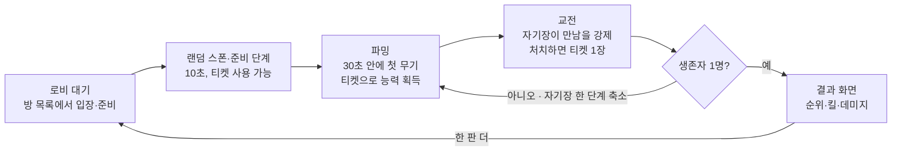
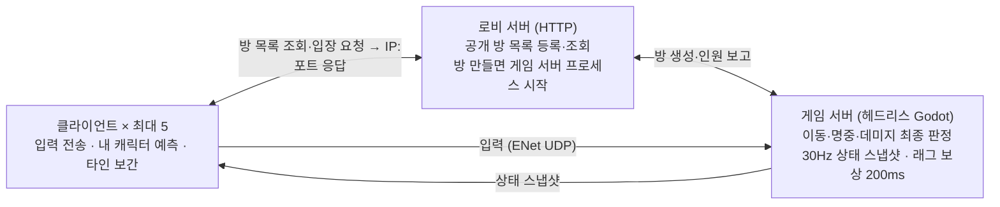

# 5인 온라인 3D 배틀로얄 PRD (Godot)

- 작성일: 2026-10-20
- 관련 문서: [WEAPON.md](WEAPON.md) (무기 기획), [ABILITY.md](ABILITY.md) (능력 기획)

---

## 1. 개요

**「라스트 파이브」(가제)는 최대 5명이 섬 곳곳에 흩어져 시작하고, 랜덤 능력과 총으로 마지막 1인을 가리는 10분짜리 1인칭 3D "능력자 배틀로얄" FPS입니다.** 엔진은 Godot 4.x, 서버 권한형(dedicated server) 온라인 구조로 만듭니다.

배그(PUBG)의 "파밍 → 자기장 → 최후의 1인" 공식은 가져오되, 두 가지를 바꿉니다. 비행기·낙하산 대신 **지정 구역 중 한 곳에 서로 겹치지 않게 랜덤 스폰**하고, **랜덤 능력 티켓**으로 번개 대쉬·분신술·터렛 같은 능력을 얻어 싸웁니다. 인원은 5명으로 줄이고 맵과 판 길이를 그에 맞게 압축합니다. 누구나 공개 방 목록에서 골라 들어와 바로 붙는 게임이 목표입니다.

### 목표

- 공개 방 목록에서 방을 골라 1분 안에 5명이 한 판을 시작한다
- 한 판 8~12분, 첫 교전까지 2분 이내
- 핑 100ms 이하에서 "내가 맞혔는데 안 맞았다"는 느낌이 없는 사격 판정
- 1인 개발 기준 약 7개월(29주) 안에 플레이 가능한 MVP

### 비목표 (이번 범위에서 하지 않음)

- 수십~100인 대규모 매치, 스쿼드(팀) 모드
- 랭크전·자동 매칭 큐, 상점·과금, 음성 채팅
- 차량, 건물 파괴, 모바일·콘솔 출시
- 비행기 탑승·낙하산 낙하 (랜덤 스폰으로 대체)

---

## 2. 게임 컨셉

**5명뿐인 만큼 맵을 작게, 자기장을 빠르게, 파밍을 짧게 만든 "포켓 배틀로얄"에, 매 판 달라지는 랜덤 능력을 얹은 "능력자 배그"가 핵심입니다.** 100인 맵에 5명을 넣으면 서로 못 만나므로, 밀도를 맞추는 것이 설계의 출발점입니다.

| 항목 | 내용 |
| --- | --- |
| 장르 | 3D 능력자 배틀로얄 FPS, 1인칭 전용 |
| 인원 | 2~5명, 개인전(FFA) |
| 한 판 길이 | 8~12분 |
| 맵 | 약 600m × 600m 섬 1개 (배그 에란겔의 약 1/180 면적) |
| 세계관 | 버려진 군 훈련 섬. 활주로, 격납고, 마을, 등대로 구성 |
| 아트 방향 | 로우폴리 스타일라이즈드 3D (1인 개발·에셋 스토어 활용에 유리) |
| 플랫폼 | Windows PC (추후 Linux) |

### 차별점

- **랜덤 능력 티켓**: 모두 티켓 2장을 들고 시작. 쓰면 번개 대쉬·분신술·고공 점프·터렛 설치·투시 같은 능력 중 하나를 무작위로 얻음. 액티브 능력은 Q/E로 발동하고 쿨타임이 있으며, 패시브 능력은 얻는 즉시 적용 (상세는 [ABILITY.md](ABILITY.md))
- **낙하 없는 랜덤 스폰**: 비행기·낙하산 없이, 지정 스폰 구역 8곳 중 서로 다른 곳에 무작위로 떨어져 바로 시작
- **들어가자마자 한 판**: 공개 방 목록에서 골라 입장, 인원이 차고 모두 준비하면 바로 시작
- **빠른 템포**: 스폰 후 30초 안에 무기를 줍도록 스폰 구역 주변 아이템 밀도를 높임
- **다시 하기 쉬움**: 판이 끝나면 같은 방으로 로비 복귀, "한 판 더" 버튼 하나
- **관전 모드**: 먼저 죽은 플레이어가 살아 있는 플레이어 시점으로 관전 (5인이라 대기 시간이 짧아도 지루하지 않게)

---

## 3. 핵심 게임 루프

**한 판은 로비 → 랜덤 스폰 → 파밍·능력 획득·교전 반복 → 결과 → 다시 로비로 이어지며, 자기장이 줄어들수록 교전이 강제됩니다.**

자기장은 4단계로 줄어들고, 마지막 단계가 끝나면 자기장이 완전히 닫혀 반드시 승자가 나옵니다. 아래 값은 초기 제안이며 플레이테스트로 조정합니다.

| 단계 | 안전구역 지름 (m) | 대기 (초) | 축소 (초) | 초당 데미지 |
| --- | --- | --- | --- | --- |
| 1 | 600 → 360 | 120 | 60 | 1 |
| 2 | 360 → 180 | 90 | 45 | 3 |
| 3 | 180 → 70 | 60 | 40 | 6 |
| 4 | 70 → 0 | 45 | 60 | 10 |

합계 약 8분 40초이며, 시작 연출과 준비 단계 약 15초를 더하면 최대 한 판이 약 9분입니다.

### 랜덤 스폰 규칙

비행기·낙하산을 없애고, 미리 정한 스폰 구역에 플레이어를 흩어 놓고 시작합니다.

| 항목 | 내용 |
| --- | --- |
| 스폰 구역 | 맵 가장자리 쪽 지정 구역 8곳 (예: 북쪽 해안 초소, 등대, 항구, 마을 동쪽, 마을 서쪽, 숲 캠프, 레이더 기지, 정비창) |
| 구역 배정 | 서버가 매치 시드로 구역을 섞어 플레이어마다 **서로 다른 구역**을 배정 (한 구역에 두 명 이상 없음) |
| 구역 간 거리 | 배정된 구역끼리 최소 150m 떨어지도록 조합을 고름 |
| 구역 안 위치 | 구역마다 스폰 포인트 6개, 그중 1개를 무작위로 고름 |
| 공개 범위 | 내 구역만 지도에 표시, 다른 사람의 구역은 알 수 없음 |
| 준비 단계 | 스폰 후 **10초**: 이동·티켓 사용 가능, 사격·능력 발동·피해 없음. 끝나면 "전투 시작" 알림과 함께 자기장 1단계 대기 시작 |
| 아이템 | 각 스폰 구역 안에 권총·기관단총·산탄총 중 하나가 반드시 나오는 무기 슬롯 2개 이상 (30초 안에 첫 무기) |

- 첫 안전구역의 중심은 무작위지만, 특정 스폰 구역이 지나치게 유리하지 않도록 맵 중앙 200m 반경 안에서만 고릅니다.
- 희귀 무기와 능력 티켓이 몰린 맵 중앙 활주로·격납고에는 스폰 구역을 두지 않습니다. 가장자리에서 시작해 중앙으로 모이게 만드는 위험-보상 구조입니다.

---

## 4. 기능 요구사항

**MVP는 P0 항목만으로 한 판이 끝까지 돌아가야 합니다.** P1은 알파 테스트 전, P2는 그 이후입니다.

| 영역 | 요구사항 | 우선순위 |
| --- | --- | --- |
| 이동 | 걷기·달리기·앉기·점프, CharacterBody3D 기반 | P0 |
| 이동 | 엎드리기, 기울이기, 창문 넘기 (Q/E는 능력 키라 기울이기 키는 따로 정함) | P2 |
| 시점 | 1인칭 전용, 조준(ADS) 시 조준경 확대. 내 화면은 팔+무기 뷰모델, 다른 사람에게는 전신 모델 | P0 |
| 사격 | 히트스캔 사격, 반동, 탄 퍼짐, 부위별 데미지(머리 2배) | P0 |
| 사격 | 저격총 탄도 낙하·비행 시간(투사체) | P2 |
| 무기 | 6계열 10종 (세부 스펙은 [WEAPON.md](WEAPON.md)) | P0 |
| 무기 | 부착물(조준경·확장 탄창), 수류탄 | P1 |
| 아이템 | 탄약, 구급상자(회복), 방탄조끼 1~2단계, 헬멧 | P0 |
| 인벤토리 | 주무기 2 + 보조무기 1 슬롯, 소모품 칸 수 제한 | P0 |
| 맵 | 600m 섬 1개, 건물 20~30채, 아이템 스폰 포인트 랜덤 | P0 |
| 스폰 | 지정 스폰 구역 8곳 중 서로 겹치지 않게 랜덤 배정, 10초 준비 단계 (3장 랜덤 스폰 규칙) | P0 |
| 능력 | 랜덤 능력 티켓: 시작 2장, 맵 스폰·처치 보상으로 추가 획득, 사용 시 무작위 능력 1개 | P0 |
| 능력 | 능력 슬롯 액티브 2(Q/E) + 패시브 2, 쿨타임, 슬롯이 차면 교체 선택 | P0 |
| 능력 | P0 능력 13종 (액티브 7: 번개 대쉬·고공 점프·방벽·분신술·터렛 설치·투시·시간 되감기, 패시브 6). 세부는 [ABILITY.md](ABILITY.md) | P0 |
| 능력 | P1 능력 7종 추가 (갈고리·치유 장판·충격파·은신 등) | P1 |
| 자기장 | 4단계 축소, 단계별 대기·축소 시간과 도트 데미지 설정 가능 | P0 |
| 판정 | 기절 없이 즉사 (5인 FFA라 소생 불필요), 최후 1인 승리 | P0 |
| 로비 | 공개 방 목록(인원·상태 표시, 새로고침), 방 만들기, 빠른 입장, 준비 버튼, 닉네임 | P0 |
| 커스터마이징 | 의상·악세사리 파츠 교체 (아래 상세) | P0 |
| UI | 체력·탄약·미니맵·자기장 타이머·생존자 수·킬 피드·능력 슬롯과 쿨타임·티켓 수 | P0 |
| UI | 결과 화면(순위·킬·데미지·보유 능력), "한 판 더" | P0 |
| 관전 | 사망 후 생존자 시점 관전 | P1 |
| 사운드 | 총소리 3D 위치 정보, 발소리 | P1 |
| 통신 | 텍스트 채팅(로비·인게임), 음성 채팅 없음 | P0 |
| 설정 | 설정 창: 기본 키 배치 + 키 재지정, 감도, 그래픽 품질 | P0 |

### 캐릭터 커스터마이징 (P0)

- 공용 캐릭터 몸체 1종 위에 파츠를 갈아 끼우는 방식 (Mixamo 호환 리그 하나로 애니메이션 공유)
- 슬롯 5개: 상의, 하의, 신발, 모자·헤어, 악세사리(안경·마스크·배낭 장식)
- MVP는 슬롯당 4~6종, 파츠별 색상 8색
- 1인칭이라 내 외형은 게임 중 팔 소매로만 보이므로, 로비 3D 미리보기를 돌려 보며 고르고, 고른 외형은 다른 플레이어에게 그대로 보임 (파츠 ID만 동기화)
- 외형은 판정에 영향 없음: 히트박스는 모두 같고, 인게임 헬멧·방탄조끼는 장비로 따로 표시

### 설정 창 (P0)

기본 키 배치를 제공하고, 설정 창에서 원하는 키로 바꿀 수 있습니다. 바꾼 값은 `user://settings.cfg`에 저장하고 실행 시 Godot `InputMap`에 다시 적용합니다.

| 동작 | 기본 키 |
| --- | --- |
| 이동 | W A S D |
| 달리기 / 앉기 / 점프 | Shift / C / Space |
| 사격 / 조준 | 마우스 왼쪽 / 마우스 오른쪽 |
| 재장전 / 줍기·상호작용 | R / F |
| 액티브 능력 1 / 2 | Q / E |
| 랜덤 능력 티켓 사용 | T |
| 새 능력 버리기 (교체 선택 창에서) | X |
| 무기 선택 | 1 / 2 / 3 |
| 인벤토리 / 지도 | Tab / M |
| 자유 둘러보기(누르는 동안) | Alt |
| 채팅 | Enter |

- 이미 쓰는 키를 지정하면 경고 후 기존 동작의 키를 비움, "기본값으로 초기화" 버튼 제공
- 그 외 설정: 마우스 감도(일반·조준 분리), Y축 반전, 시야각(FOV) 80~103, 그래픽 품질 3단계, 음량

### 텍스트 채팅 (P0, 음성 채팅 없음)

- 로비 채팅과 인게임 전체 채팅, Enter로 입력, 한 번에 최대 100자
- 죽은 플레이어의 채팅은 생존자에게 보이지 않음 (위치 정보 유출 방지)
- 메시지는 서버가 중계하며 초당 2개로 제한, 개인 뮤트, 방장 강퇴, 기본 비속어 필터

---

## 5. 멀티플레이 네트워크 설계

**방 하나당 헤드리스 Godot 게임 서버 프로세스 하나가 모든 판정을 맡고, 로비 서버는 공개 방 목록만 관리합니다.**

클라이언트는 로비 서버에서 방을 고른 뒤 게임 서버에 직접 붙고, 그 뒤로는 게임 서버와만 통신합니다.

### 공개 방 규칙

- 누구나 방을 만들 수 있고, 모든 방은 로비 목록에 공개됨 (방 이름, 인원 n/5, 상태: 대기·게임 중)
- 최소 2명, 최대 5명. 인원이 다 차거나 모두 준비하면 10초 카운트다운 후 시작
- 게임 중인 방은 새로 들어올 수 없고, 끊긴 플레이어만 60초 안에 재접속 가능
- 방장이 나가면 다음 입장자가 방장을 이어받음

### 동기화 방식 (Godot 고수준 멀티플레이)

| 대상 | 방식 | 빈도 |
| --- | --- | --- |
| 플레이어·아이템 생성/제거 | `MultiplayerSpawner` | 이벤트 발생 시 |
| 위치·회전·애니메이션 상태 | `MultiplayerSynchronizer` + 클라이언트 보간(100ms) | 30Hz |
| 이동 입력 | 클라이언트 → 서버 unreliable RPC, 서버가 위치 보정 | 30Hz |
| 사격 | `request_fire(발사 위치, 방향, 틱)` reliable RPC → 서버가 탄약·연사 속도 검증 후 히트스캔 | 발사 시 |
| 데미지·킬·자기장·채팅 | 서버 → 전체 reliable RPC | 이벤트 발생 시 |
| 티켓 사용·능력 발동 | 클라이언트 → 서버 `request_ability(슬롯, 틱)` reliable RPC → 서버가 쿨타임·상태 검증 후 효과 적용, 결과를 전체에 전송 (투시 결과는 사용자에게만) | 사용 시 |
| 분신·터렛·방벽 | 서버가 생성하는 엔티티로 스폰, 분신은 진짜 플레이어와 같은 형식으로 동기화 | 이벤트 발생 시 |
| 캐릭터 외형 | 입장 시 파츠 ID 배열만 전송 | 1회 |

- 1인칭 전용이므로 다른 플레이어의 시선 방향(pitch)도 함께 동기화해 상체·무기 방향을 맞춤
- 대역폭 예상: 플레이어 1명 상태 약 40바이트 × 5명 × 30Hz = 클라이언트당 하향 약 6KB/s (목표 30KB/s 이하)
- 개발 중에는 한 사람이 서버를 겸하는 listen server 모드도 지원해 서버 없이 테스트

---

## 6. 기술 스택과 비기능 요구사항

**Godot 4 내장 기능(ENet + 고수준 멀티플레이 API)만으로 MVP를 만들고, 외부 서비스는 로비 서버 하나만 둡니다.**

| 구분 | 선택 | 이유 |
| --- | --- | --- |
| 엔진 | Godot 4.x (최신 안정 버전 고정) | 무료, 헤드리스 서버 빌드 지원 |
| 언어 | GDScript (무거운 계산만 C# 또는 GDExtension) | 빠른 반복, 문서·예제 풍부 |
| 렌더러 | Forward+ (저사양은 Mobile 렌더러 옵션) | 3D 조명·그림자 품질 |
| 물리 | Jolt Physics (Godot 4.4+ 내장) | 기본 물리보다 안정적이고 빠름 |
| 네트워크 | ENetMultiplayerPeer (UDP) | 내장, 5인 규모에 충분 |
| 동기화 | MultiplayerSpawner, MultiplayerSynchronizer, RPC | 스폰·상태 복제를 엔진이 처리 |
| 서버 | 헤드리스 Godot 리눅스 빌드, 소형 VPS(2 vCPU, 2GB) | 1대에 방 여러 개 프로세스로 운영 |
| 매칭 | 로비 서버(HTTP): 공개 방 등록·목록 조회, 입장 시 IP:포트 안내 | 5인 공개 방 목록 규모에 충분 |
| 버전 관리 | Git + Git LFS (모델·텍스처) | 대용량 에셋 관리 |
| 에셋 | Kenney, Quaternius 등 CC0 로우폴리 + Mixamo 애니메이션 | 아트 비용 최소화 |

### 비기능 요구사항

- **성능**: GTX 1060급에서 1080p 60fps, 서버 틱 30Hz
- **네트워크**: 플레이어당 하향 30KB/s 이하, 핑 150ms까지 플레이 가능
- **보안**: 클라이언트는 입력만 보내고, 명중·데미지·아이템 획득·티켓 뽑기·능력 쿨타임은 서버가 판정 (스피드핵·데미지 조작·능력 연사 차단)
- **안정성**: 플레이어가 끊겨도 판은 계속, 60초 안에 재접속하면 같은 캐릭터로 복귀
- **빌드 크기**: 클라이언트 1GB 이하

---

## 7. 마일스톤과 범위

**가장 어려운 네트워크를 M1에서 먼저 검증하고, 1인 개발 기준 29주 안에 알파 테스트까지 갑니다.** 능력 시스템이 추가된 대신 비행기·낙하가 빠져 배틀로얄 루프 기간을 줄였습니다.

| 단계 | 기간 | 주요 작업 | 다음 단계로 가는 조건 |
| --- | --- | --- | --- |
| M1 네트워크 프로토타입 | 1~4주 | 캡슐 캐릭터, ENet 접속, 이동·사격 동기화, 헤드리스 서버 빌드, 래그 보상 | 5명 접속·끊김 없음 |
| M2 코어 전투 | 5~10주 | 무기 10종([WEAPON.md](WEAPON.md)), 데미지·방어구, 인벤토리, 줍기, HUD, 1인칭 뷰모델 | 1:1 교전이 재밌다 |
| M3 능력 시스템 | 11~15주 | 랜덤 능력 티켓·뽑기, 능력 슬롯·쿨타임·교체, P0 능력 13종([ABILITY.md](ABILITY.md)), 능력 HUD | 능력 있는 1:1 교전이 능력 없을 때보다 재밌다 |
| M4 배틀로얄 루프 | 16~19주 | 600m 맵, 스폰 구역 8곳·랜덤 배정·준비 단계, 자기장 4단계, 승리 판정, 결과 화면, 관전 | 한 판이 끝까지 돈다 |
| M5 로비·커스터마이징 | 20~24주 | 로비 서버, 공개 방 목록, 텍스트 채팅, 캐릭터 의상·악세사리, 설정 창 | 공개 방으로 5명 입장 |
| M6 폴리시·알파 테스트 | 25~29주 | 사운드·이펙트·최적화, 능력 밸런스 조정, 버그 수정, 외부 플레이어 5인 테스트 3회 | 성공 지표 달성 |

```mermaid
gantt
    title MVP 로드맵 (1인 개발, 주 20시간 기준)
    dateFormat  X
    axisFormat  %s주
    section 개발
    M1 네트워크 프로토타입   :m1, 0, 4
    M2 코어 전투             :m2, after m1, 6
    M3 능력 시스템           :m3, after m2, 5
    M4 배틀로얄 루프         :m4, after m3, 4
    M5 로비·커스터마이징     :m5, after m4, 5
    M6 폴리시·알파 테스트    :m6, after m5, 5
```

주차는 주 20시간 투입을 가정한 추정치입니다. 일정이 밀리면 관전·부착물·투척물·P1 능력부터 뒤로 미룹니다.

---

## 8. 성공 지표, 리스크, 열린 질문

**알파 테스트의 합격선은 "5명이 연속 3판을 오류 없이 하고 한 판 더 하자고 하는가"입니다.**

### 성공 지표

| 지표 | 목표 |
| --- | --- |
| 평균 한 판 길이 | 8~12분 |
| 스폰 후 첫 교전까지 | 2분 이내 |
| 1인당 판당 능력 사용 횟수 | 15회 이상 |
| 전설 능력 보유자 승률 우위 | 10%p 이하 |
| 한 세션당 판 수 | 3판 이상 |
| 매치 중 접속 끊김/크래시 | 20판당 1회 이하 |
| "맞았는데 안 맞았다" 체감 설문 | 5점 만점에 4점 이상 |

### 리스크와 대응

| 리스크 | 대응 |
| --- | --- |
| 네트워크 동기화(예측·래그 보정)가 가장 어렵고 일정을 잡아먹음 | M1에서 큐브 2개로 네트워크부터 검증, 그래픽은 나중에 |
| 3D 아트·애니메이션 제작량 | CC0 에셋과 Mixamo 우선, 자체 제작은 맵 배치에 집중 |
| 1인칭 뷰모델(팔+무기)과 전신 모델을 따로 만들어야 함 | 무기마다 뷰모델 1개 + 월드 모델 1개로 분리, 팔 모델은 공용 1종 |
| 1인칭 멀미 | FOV 설정(80~103), 화면 흔들림 끄기 옵션 제공 |
| 랜덤 능력 운빨로 "억울한 패배" 체감 | 능력 직접 데미지 상한 30, 모든 능력에 카운터, 처치 보상 티켓으로 역전 기회, 등급별 승률 모니터링 ([ABILITY.md](ABILITY.md) 6장) |
| 능력 13종 구현·네트워크 동기화 부담 | 효과 타입 6가지(순간이동·도약·소환·시야·회복·스탯 보정) 조합으로 구현, 일정이 밀리면 P0를 10종으로 축소 |
| 스폰 구역 유불리 | 구역별 승률·첫 교전 시간 집계 후 아이템 배치 조정 |
| 5명을 모으기 어려움 | 봇 AI(단순 배회·사격)로 빈자리 채우기를 P1로 검토 |
| 서버 비용·운영 | 초기엔 호스트가 서버를 겸하는 listen server도 지원해 비용 0원으로 테스트 |
| 핵 사용 | 서버 권한 구조로 대부분 차단, 공개 방은 방장 강퇴로 대응 (별도 안티치트는 범위 밖) |

### 열린 질문

- [ ] 개발 인원은 몇 명이고, 주당 투입 가능 시간은?
- [x] 시점은 1인칭 전용으로 확정
- [ ] 스팀 출시를 목표로 하는가? (스팀이면 로비 서버를 Steam 로비·릴레이로 교체 가능)
- [ ] 게임 제목 확정
- [x] 비행기·낙하산 없이 지정 구역 랜덤 스폰으로 확정
- [x] 랜덤 능력 티켓 기반 "능력자 배그"로 확정 (능력 세부 열린 질문은 [ABILITY.md](ABILITY.md) 8장)
